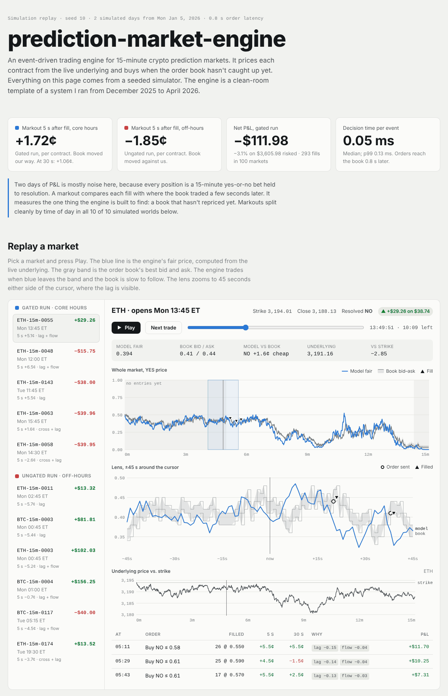
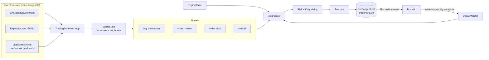

# prediction-market-engine

An event-driven trading engine for short-duration binary prediction markets ("will BTC be above its opening price in 15 minutes?"), with a deterministic market simulator to run it against.

This is a **clean-room template** of the architecture behind an automated trading system I built and ran on crypto prediction markets from December 2025 to April 2026. The production system was sold, so its code, tuned parameters, account lists and venue integration are not here. What is here is the same structure, rewritten from scratch: the signal families, how they're combined, the risk and execution layers, the monitoring that kept the strategy honest, and a simulator that reproduces the market features the strategy depended on.

Every number in `config.py` is a placeholder chosen so the simulator runs end to end.

## Demo

**[Live demo](https://evanli2060.github.io/prediction-market-engine/demo.html)**: a self-contained page ([`docs/demo.html`](docs/demo.html)) that replays a simulated run. Pick a market, press Play, and watch the engine's fair price move ahead of a lagging order book while it trades.

[](https://evanli2060.github.io/prediction-market-engine/demo.html)

Rebuild it with `python -m pmbot.demo --seeds 10 --out docs/demo.html` (about two minutes).

## Quick start

No dependencies beyond the standard library (Python 3.10+).

```bash
pip install -e ".[dev]"            # or just: export PYTHONPATH=src
python -m pmbot.cli                # 2 simulated days, time-of-day gating on
python -m pmbot.cli --no-regime    # trade around the clock and compare
python -m pmbot.cli --seeds 10     # distribution across 10 simulated worlds
python -m pmbot.demo               # build the HTML replay page
pytest
```

## Architecture



Everything the bot reacts to is one typed event (`models.py`): underlying ticks, book updates, public trades, operator signals, market open/resolve, fills and order-closed notices. Live feeds, the simulator and the replayer all emit the same stream, so the engine never knows which one it's on. That's what makes record-and-replay testing possible: capture a live session, then re-run any strategy change against it with the same fill model.

## Signals

| Signal | Idea | Inputs |
|---|---|---|
| `lag_momentum` | The market's book reprices off the underlying, but not instantly. Compute fair value from the live underlying (lognormal, realized vol, momentum tilt) and trade when the book hasn't caught up. | Underlying ticks, book |
| `cross_market` | Correlated underlyings usually finish on the same side of their strikes. When the leader's market is strongly one-sided and the follower's hasn't caught up, lean the follower. | Both books |
| `order_flow` | Weighted public flow. Weights come from scoring accounts on resolved history (`analysis/account_scoring.py`): durable edge gets positive weight, reliably-wrong or fading accounts get negative weight. | Public tape |
| `manual` | Operator bias with a short TTL for scheduled macro events, where the underlying moves faster than the automated signals react. Expires on its own. | stdin console |

Each signal returns a score in [-1, 1] and a confidence. The aggregator weights them, drops any the decay monitor has switched off, shrinks the result when signals disagree, scales it by the time-of-day regime, and only acts if the implied probability clears the spread by a minimum edge.

## Engine

- **Volatility** (`state.py`): bipower variation over 30 minutes, updated incrementally. It's robust to single jumps; plain realized variance over a short window let one large move distort the fair price for minutes, which was enough to cancel the lag edge in simulation.
- **Regime gate** (`engine/regime.py`): labels every moment with a regime and size multiplier. Windows live in config because the right ones move as other participants adapt.
- **Markouts** (`bot.py`): every fill is marked against the book 5 s and 30 s later. A positive markout means the bot bought before the book moved its way, which is the edge it's built for, measured without waiting for the binary outcome.
- **Decay monitor** (`engine/monitor.py`): keeps a rolling markout per (signal, regime), one sample per market. A signal is switched off in a regime only when its mean is *confidently* below zero (one-sided t-test), then comes back on probation after a cooldown. It can judge on realized P&L instead (`MonitorConfig.metric = "pnl"`), but that takes far longer to separate edge from luck.
- **Risk** (`engine/risk.py`): fractional Kelly sizing; per-market, total and cash limits checked at the order's *limit* price and including orders still in flight; a daily loss stop; no entries early in a window, near resolution, or at prices outside 10–90¢; per-market cooldowns; never both sides of a market.
- **Execution** (`engine/execution.py`): IOC limit orders with a slippage allowance that can never consume the whole edge. Stale books are refused, and any decision that took longer than the latency budget is dropped. Every order ends with exactly one `OrderClosed`, which is what releases it from the in-flight set.
- **Paper exchange** (`engine/paper.py`): fills against the first book snapshot at least `latency` seconds after submission, walking levels up to the limit.

State updates are O(1) amortized per event, so a full decision takes about 0.05 ms median and 0.13 ms p99 in the simulator.

## Simulator

`sim/environment.py` generates the event stream from a seeded model with the structural features the strategy depends on. Its parameters are invented so each mechanism is visible; none of it is calibrated to real data.

- Two correlated underlyings with a slow trend term, so short-horizon momentum carries a little information.
- Makers quoting off a **stale** underlying price during core hours. The lag shrinks over the run to mimic competing bots arriving. Spreads widen into resolution.
- **Adverse selection off-hours**: the book is set by participants effectively ahead of the public price, and late-window reversals are more frequent, so apparent mispricings are traps.
- Synthetic accounts on the tape: a couple with modest edge, one that fades an informed account, and a crowd of noise.
- A scheduled macro event with drift, and an operator signal shortly after it.

## Results in simulation

Ten seeds, two simulated days each, the same worlds traded gated (09:30–16:00 ET) and ungated:

| | Gated | Ungated |
|---|---|---|
| Markout 5 s after fill | +1.31 to +1.72¢ per contract, positive in **10 / 10** seeds | core hours +1.03 to +2.04¢; off-hours **−0.97 to −1.85¢, negative in 10 / 10** |
| Two-day return per $ risked | mean +0.3%, 6 / 10 positive (range −13% to +15%) | mean +0.0%, 5 / 10 positive (range −17% to +14%) |

- **P&L over two days can't tell these apart.** Every position is a 15-minute yes-or-no bet held to resolution, so a run's return is dominated by a few dozen coin flips.
- **Markouts can.** During core hours the engine buys before the book reprices; off-hours it buys into better-informed flow.
- **Markouts also expose latency.** On the same world (seed 10, gated), core-hours markouts go from +1.72¢ at 0.8 s order latency to −0.39¢ at 3 s and −2.04¢ at 15 s. The 3 s run still happened to return +8.5%.
- **The decay monitor learns the time gate by itself.** Judging on markouts, the ungated engine switched `lag_momentum` off for off-hours in 10 of 10 seeds, and never switched anything off in core hours.
- **The markout isn't turned into profit.** Positions are held to resolution, so a ~1.6¢ mispricing is small next to each contract's ±$1 outcome, and the simulator's late reversals take part of it. An exit leg that sells once the book catches up would realize some of the markout (less the spread to get out) instead of taking the outcome risk. That's the clearest next step for this template.

Other things the per-run report (`python -m pmbot.cli`) surfaces:

- **By minutes into window**: early-window entries were the weakest, which is why `entry_delay_s` is 300.
- **By signal**: markout and return for the fills each signal argued for.
- **Account scoring**: with only one warm-up day, a pure-noise account can look skilled (seed 10 scores one at 75% over 49 markets). Shrinkage and a minimum history reduce this but don't eliminate it, so weights should be re-estimated on rolling history rather than trusted once.

## Testing

`pytest` runs 49 tests: unit tests per component, record/replay determinism, and regression tests for the bugs fixed during review (an in-flight order on the other side of a market, caps checked at the wrong price, the live feed merger spinning on a finished producer). CI runs ruff and the suite on Python 3.10–3.13 on Linux, plus Windows and macOS. Types check clean under pyright.

## Layout

```
src/pmbot/
  models.py            events, markets, books, orders
  config.py            all parameters (placeholders)
  pricing.py           binary fair value
  state.py             incremental world state, jump-robust volatility
  bot.py               the event loop, markouts
  signals/             lag_momentum, cross_market, order_flow, manual
  engine/              aggregator, regime, monitor, risk, portfolio, execution, paper exchange
  sim/                 seeded market simulator
  io/                  JSONL record and replay
  analysis/            account scoring, run report
  live/                feed merging + operator console (implemented); venue adapters (stubs)
  demo/                builds the HTML replay page
  cli.py
tests/                 unit, regression, record/replay and determinism tests
docs/demo.html         the replay page; docs/DESIGN_NOTES.md: how the design evolved
```

## Going live

`live/sources.py` implements the part that's venue-independent: merging any number of websocket producers into one ordered stream (failing loudly if one dies, dropping one that finishes), plus a non-blocking operator console (`+ 90 note` → +1 for 90 seconds). The producers for the underlying feed, the market websocket and market discovery, and the order-routing adapter in `live/exchange.py`, are documented stubs. A live adapter must report fills and an `OrderClosed` for every order through the event stream.

## Disclaimer

Educational code. Not financial advice, not affiliated with any exchange or prediction market. Check a venue's terms and your jurisdiction's rules before trading on it.
